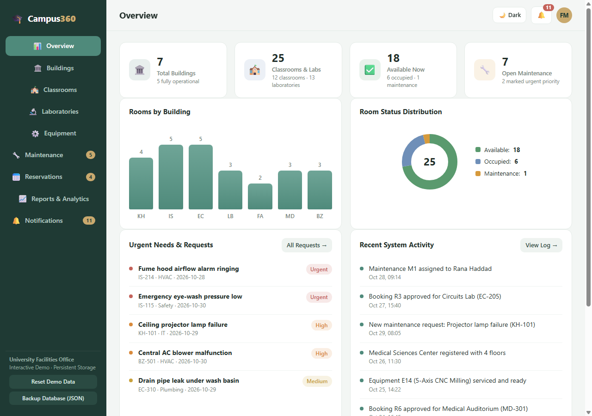

# 🎓 Campus360 — Smart University Facilities Management

> A modern, responsive, and full-featured facilities management dashboard for universities and higher-education institutions.



---

## 🌟 Key Features

- **📊 Comprehensive Facilities Overview**: Real-time stats for buildings, classrooms, laboratories, equipment readiness, urgent issues, and recent activities.
- **🏛️ Building Management & Interactive Floor Map**: Complete CRUD operations, real-time status badges, and an interactive visual floor plan from Ground to upper floors.
- **🏫 Classrooms & 🔬 Laboratories**: Filter by building and status, check capacity, view upcoming reservation schedules, and trigger reservations directly.
- **⚙️ Equipment Tracking**: Filter by condition (Good, Fair, Damaged), toggle availability with one click, and record maintenance service dates.
- **🔧 Maintenance Work Orders**: Filter by priority, status, and category. Inline updates for technician assignment, priority, and progress. Full problem details modal.
- **📅 Reservations & Intelligent Conflict Prevention**: Booking requests with date/time picker, one-click Approve/Reject, and automated conflict detection preventing overlapping schedules for the same room.
- **📈 Reports & Visual Analytics**: Bar charts, SVG donut charts, and facilities comparison table. Includes **Export to CSV** and **Print / PDF** support.
- **🔔 Real-time Alerts & Activity History**: Dynamic badge counters in header and sidebar, dropdown preview, and full activity log.
- **💾 Local Persistence & Data Management**: Auto-saves state in `localStorage`. Includes *Reset Demo Data* and *Backup Database (JSON)* tools.
- **🌙 Dark & Light Themes**: Seamless theme switcher with persistent user preference.
- **📱 Fully Responsive**: Optimized for desktop, tablets, and mobile devices with slide-out drawer navigation.

---

## 🚀 Quick Start / How to Run

### Method 1: Direct File Launch (No Install Required)
Simply double-click:
```bash
index.html
```
The application will open in any web browser (Chrome, Edge, Firefox, Safari) immediately with full interactivity.

### Method 2: Local Web Server
Double-click:
```bash
start-server.bat
```
This launches a lightweight local HTTP server at `http://localhost:3000` with zero dependencies.

---

## 🛠️ Tech Stack

- **React 18** (Components, Hooks, State Management)
- **CSS3** (Custom Properties, Flexbox, CSS Grid, Responsive Design, Print Styles)
- **SVG / Canvas** (Custom dynamic Donut and Bar charts)
- **LocalStorage API** (Persistent browser storage)

---

## 📄 License
MIT License. Free to use and customize for university facility operations.
